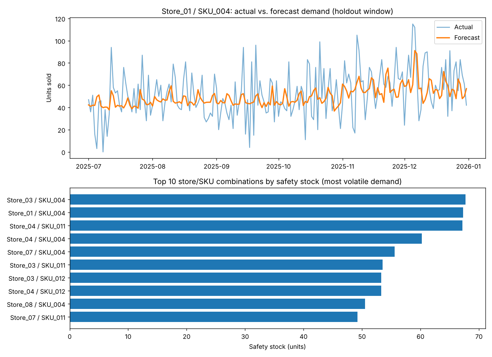

# Franchise Demand & Reorder Dashboard

A demand forecasting and inventory reorder tool, built around a scenario
that's common for distributors supplying multiple franchise or retail
locations: each store orders on its own schedule, and the SCM team needs a
way to predict demand and flag stock before it runs out or piles up.



## The scenario

A distributor supplies 8 store locations with 12 SKUs (a mix of frozen,
refrigerated, and shelf-stable grocery items). Stores currently place orders
manually, which leads to the two usual failure modes: stockouts on popular
items and overstock on slower-moving or perishable ones. This project
forecasts daily demand per store/SKU and converts that forecast into a
concrete reorder recommendation, the same calculation an SCM analyst would
run by hand or in a spreadsheet.

## About the data

The dataset (`data/daily_demand.csv`) is simulated, not scraped from a real
company. It's generated in `src/generate_data.py` to match the statistical
shape of real retail demand: a mild upward trend, weekend and holiday-season
spikes, periodic promotion weeks, and different baseline volume per store
and per SKU. I built it this way instead of using a public dataset because
most of the genuinely "real" SCM datasets (vendor invoices, store-level
inventory feeds) aren't public, and the available public retail datasets
don't let me control the patterns. Simulating it means I know exactly what
trend, seasonality, and promotions are in the data, so I can check whether
the model actually picks them up. The structure matches how public datasets
like Kaggle's Store Item Demand Forecasting Challenge or the M5/Walmart
dataset are laid out, so swapping in real data later is mostly a matter of
matching column names.

## Pipeline

1. `src/generate_data.py` - builds the synthetic daily demand data
2. `src/features.py` - lag features, rolling averages, calendar features
3. `src/forecast_model.py` - trains a gradient boosting model
   (scikit-learn's `HistGradientBoostingRegressor` by default; swap in
   XGBoost by flipping `USE_XGBOOST = True` if you have it installed) and
   evaluates it with WAPE, the standard accuracy metric in supply chain
   forecasting
4. `src/inventory_calc.py` - turns the forecast into a safety stock and
   reorder point per store/SKU, using the model's own forecast error to
   size the safety buffer rather than just raw demand variance
5. `app.py` - a Streamlit dashboard to explore the results

## Running it

```bash
pip install -r requirements.txt

python3 src/generate_data.py
python3 src/forecast_model.py
python3 src/inventory_calc.py

streamlit run app.py
```

If you just want to look at the results without installing Streamlit,
`src/make_preview.py` renders the same core charts to a static PNG
(`data/preview.png`).

## Current model accuracy

On the holdout window (last 6 months of the simulated data), the model
gets a WAPE of about 0.25, meaning forecasts are off by roughly a quarter of
total volume on average. To check that the model is actually adding value,
I compared it against simple baselines on the same window:

| Method | WAPE |
|---|---|
| Yesterday's sales (lag 1) | 0.36 |
| Same day last week (lag 7) | 0.37 |
| 7-day moving average | 0.28 |
| 28-day moving average | 0.27 |
| Gradient boosting model | **0.255** |

The model beats every baseline, but only modestly beats a 28-day moving
average. That's expected here: the simulated data has a lot of random
day-to-day noise built in, which no model can predict. Promo days are
actually forecast better than normal days (WAPE 0.20 vs 0.26), since the
promo flag is a known feature. Most of the remaining error is that random
noise, not missed spikes.

## What's simplified

- Lead time is fixed at 4 days for every store/SKU; a real system would
  pull this from actual carrier/vendor data.
- The dashboard's portfolio view assumes current stock equals the reorder
  point, since there's no live inventory feed here - swap in real on-hand
  quantities and the "critical / reorder soon / overstock" flags become
  immediately useful.
- One model is trained across all stores and SKUs (with store/SKU as
  features) rather than a separate model per series. That's a deliberate
  choice: it lets slower-selling SKUs borrow statistical strength from
  similar ones, which tends to generalize better than 96 separate small
  models.
